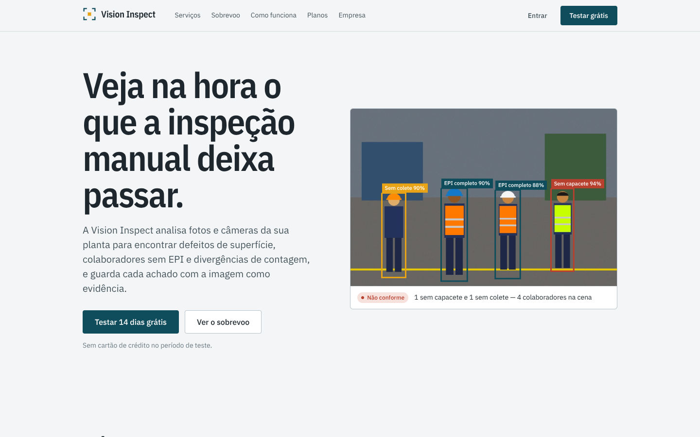
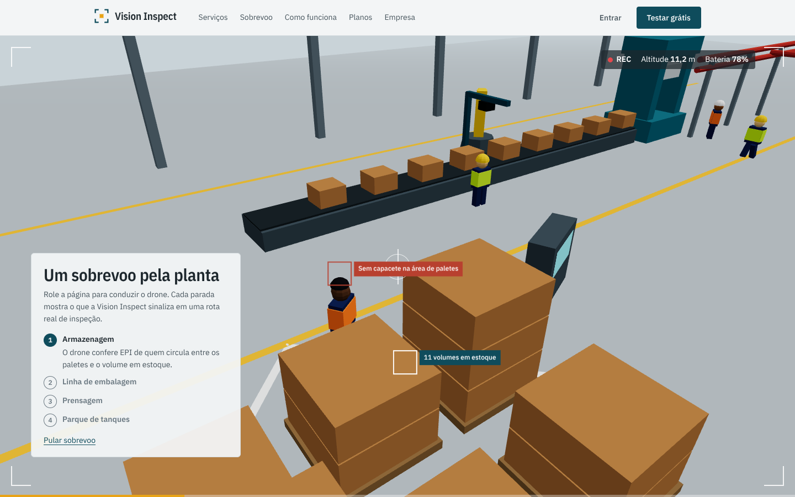
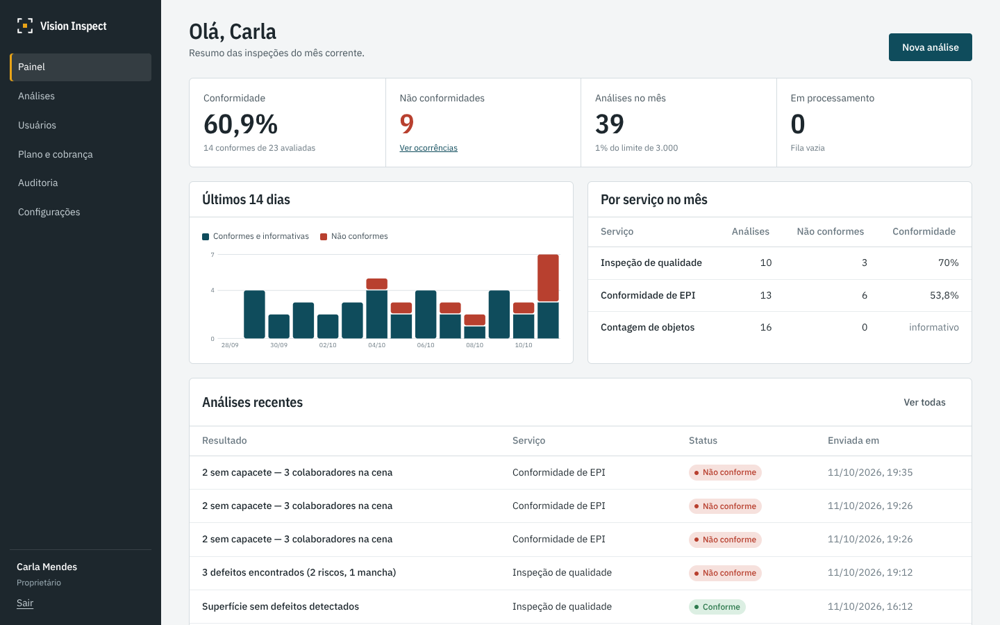
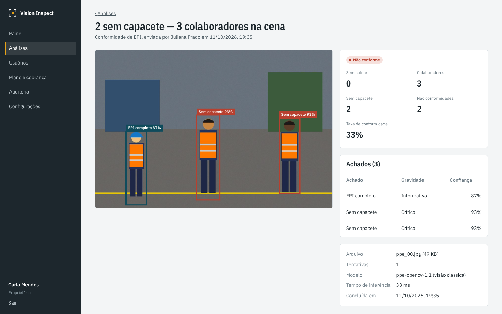
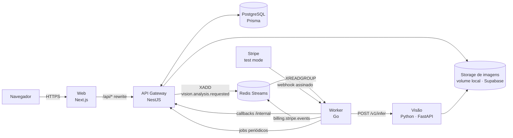

# Vision Inspect

Plataforma SaaS de **inspeção visual industrial** para pequenas e médias indústrias. Fotos e câmeras da planta são analisadas por modelos de visão computacional para encontrar **defeitos de superfície**, **colaboradores sem EPI** e **divergências de contagem**, com cada achado registrado com imagem, posição e horário para auditoria.

| | |
|---|---|
| **Problema** | Inspeção visual manual é amostral, cansativa e sem evidência: defeitos chegam ao cliente, não conformidades de EPI só aparecem depois do acidente e a contagem de expedição diverge do sistema. |
| **Público-alvo** | Indústrias de 20 a 500 colaboradores (metalurgia, embalagens, alimentos, logística) com coordenação de qualidade e/ou SESMT, sem time interno de dados. |
| **Proposta de valor** | Inspeção 100% das imagens, em segundos, com histórico auditável e indicadores por linha — contratada como assinatura mensal, sem projeto de TI. |

| Landing | Sobrevoo 3D guiado pelo scroll |
|---|---|
|  |  |
| **Painel da empresa** | **Resultado de uma análise** |
|  |  |

---

## Sumário

- [Visão geral da arquitetura](#visão-geral-da-arquitetura)
- [Stack e justificativas](#stack-e-justificativas)
- [Rodando localmente](#rodando-localmente)
- [Testes](#testes)
- [Estrutura de pastas](#estrutura-de-pastas)
- [Documentação detalhada](#documentação-detalhada)

## Visão geral da arquitetura



- **NestJS** é o API Gateway e o dono do domínio: autenticação, autorização, multiempresa, planos, assinaturas, auditoria e o único serviço que escreve no Postgres.
- **Go** cuida de tudo que é assíncrono e precisa de performance/confiabilidade: consumo de filas, retries, DLQ, webhooks do Stripe e jobs periódicos.
- **Python** executa a inferência de visão computacional (YOLO quando há pesos treinados; pipelines OpenCV como fallback).

Detalhes em [docs/arquitetura.md](docs/arquitetura.md) e [docs/filas.md](docs/filas.md).

## Stack e justificativas

| Camada | Tecnologia | Por quê |
|---|---|---|
| Frontend | **Next.js 15** (App Router), React 19, CSS Modules | SSR/SSG para a landing (SEO), app autenticado client-side; rewrites `/api/*` tornam o cookie de sessão first-party |
| 3D da landing | **Three.js + React Three Fiber**, **GSAP ScrollTrigger**, **Lenis** | cena procedural (zero assets), câmera guiada pelo scroll, renderização pausada fora da tela |
| API | **NestJS 11** + **DDD** | módulos por contexto delimitado, injeção de dependência para portas/adaptadores, ecossistema maduro |
| ORM | **Prisma 7** (driver adapter `pg`) | schema declarativo, migrations versionadas, client tipado e sem binário de query engine em runtime |
| Banco | **PostgreSQL 16** (Supabase em produção) | relacional, JSONB para resultados de inferência, plano gratuito gerenciado |
| Filas | **Redis Streams** | consumer groups, ACK, reprocessamento de pendentes (XAUTOCLAIM) e persistência — sem operar um broker a mais |
| Worker | **Go 1.24** | concorrência barata (goroutines), binário estático de ~10 MB, baixo consumo de memória em planos gratuitos |
| Visão | **Python 3.12**, FastAPI, OpenCV, Ultralytics YOLO (opcional) | ecossistema de visão computacional; modelos open source |
| Pagamentos | **Stripe** (somente test mode) | checkout hospedado, portal do cliente, webhooks assinados |
| Auth | JWT (access 15 min) + refresh token opaco rotativo em cookie httpOnly | revogação real de sessão, detecção de reuso de token |
| Infra local | **Docker Compose** | sobe Postgres, Redis, API, worker, visão e web com um comando |
| CI/CD | **GitHub Actions** | lint, tipos, unitários, integração, build, E2E e deploy semi-automático |

## Rodando localmente

> Passo a passo completo — primeira execução, como mudar o banco, criar endpoints, rodar cada teste e resolver erros comuns — em **[docs/guia-de-desenvolvimento.md](docs/guia-de-desenvolvimento.md)**.

### Opção A — tudo em Docker

```bash
cp .env.example .env            # ajuste JWT_ACCESS_SECRET e INTERNAL_API_TOKEN
docker compose up -d --build    # postgres, redis, migrate+seed, api, worker, vision, web
```

Abra <http://localhost:3000>.

### Opção B — desenvolvimento (hot reload)

Pré-requisitos: Node 22, Go 1.24, Python 3.11+, Docker (para Postgres e Redis).

```bash
cp .env.example .env
docker compose up -d postgres redis

npm install                                   # instala web + api (gera o Prisma Client)
npm run prisma:migrate -w apps/api            # aplica as migrations
npm run prisma:seed -w apps/api               # planos, empresa demo e análises de exemplo

npm run dev:api                               # http://localhost:4000
npm run dev:web                               # http://localhost:3000

# serviço de visão
cd services/vision && python -m venv .venv && . .venv/bin/activate   # Windows: .venv\Scripts\activate
pip install -r requirements-dev.txt
uvicorn app.main:app --reload --port 8000

# worker
cd services/worker
set -a && source ../../.env && set +a         # Git Bash / Linux / macOS
go run ./cmd/worker
```

### Acessos de demonstração (seed)

> Valem apenas para o ambiente local. Em produção o seed exige `SEED_ADMIN_PASSWORD` — veja [docs/deploy.md](docs/deploy.md#segredos-checklist-antes-de-publicar).

| Papel | E-mail | Senha |
|---|---|---|
| Proprietária | `carla@horizonte.ind.br` | `Horizonte@2026` |
| Administrador | `rafael@horizonte.ind.br` | `Horizonte@2026` |
| Inspetora (operador) | `juliana@horizonte.ind.br` | `Horizonte@2026` |
| Leitura | `marcos@horizonte.ind.br` | `Horizonte@2026` |
| Admin da plataforma | `admin@visioninspect.com.br` | `Plataforma@2026` |

### Stripe em modo de teste (opcional)

```bash
# 1. chaves de teste em .env (STRIPE_SECRET_KEY=sk_test_...)
npm run stripe:bootstrap -w apps/api          # cria produtos/preços e imprime STRIPE_PRICE_*
# 2. encaminhar webhooks para o worker
stripe listen --forward-to localhost:8080/webhooks/stripe   # copie o whsec_ para STRIPE_WEBHOOK_SECRET
```

Cartão de teste: `4242 4242 4242 4242`, qualquer data futura, qualquer CVC. Detalhes em [docs/stripe.md](docs/stripe.md).

## Testes

| Suíte | Comando | O que cobre |
|---|---|---|
| Unitários (API) | `npm test -w apps/api` | regras de domínio, RBAC, limites de plano, máquina de estados da assinatura, rotação de refresh token, contratos de evento |
| Integração (API) | `npm run test:integration -w apps/api` | HTTP real + Postgres + Redis: auth, RBAC, isolamento entre empresas, fila, eventos de cobrança |
| Worker (Go) | `cd services/worker && go test -race ./...` | consumo, retry com backoff, DLQ, reassunção de pendentes, assinatura de webhook, mapeamento Stripe, lock de jobs |
| Visão (Python) | `cd services/vision && pytest` | acurácia mínima sobre dados sintéticos, contrato da API, regras do backend YOLO |
| E2E | `npm run test:e2e -w apps/web` | login, gestão de usuários, upload → fila → resultado, checkout de teste |

Estratégia completa em [docs/testes-e-ci.md](docs/testes-e-ci.md).

## Estrutura de pastas

```
.
├── apps/
│   ├── api/                 NestJS (API Gateway + domínio)
│   │   ├── prisma/          schema, migrations versionadas, seed
│   │   ├── src/modules/     um diretório por contexto: identity, tenancy, billing, inspection, audit
│   │   │   └── <contexto>/  domain/ · application/ · infrastructure/ · interfaces/http/
│   │   ├── src/shared/      kernel compartilhado (erros, clock, config, prisma, redis, guards)
│   │   └── test/            testes de integração
│   └── web/                 Next.js (landing + app)
│       ├── src/app/         rotas: (marketing), (auth), app/*
│       ├── src/components/  drone/ (cena 3D), landing/, app/
│       └── e2e/             Playwright
├── services/
│   ├── worker/              Go: cmd/worker + internal/{stream,analysis,billing,scheduler,...}
│   └── vision/              Python: app/ (FastAPI + detectores), training/, scripts/, samples/
├── packages/contracts/      JSON Schemas + exemplos dos eventos (fonte única de verdade)
├── docs/                    documentação técnica e de produto
├── .github/workflows/       CI e deploy
├── docker-compose.yml
└── render.yaml              blueprint de deploy (API e worker)
```

## Documentação detalhada

| Documento | Conteúdo |
|---|---|
| [docs/guia-de-desenvolvimento.md](docs/guia-de-desenvolvimento.md) | **comece aqui:** subir o projeto, fluxo de mudanças, testes, problemas comuns |
| [docs/arquitetura.md](docs/arquitetura.md) | componentes, camadas DDD, decisões e trade-offs |
| [docs/filas.md](docs/filas.md) | por que fila, por que Go, Redis Streams, eventos, retry, DLQ |
| [docs/stripe.md](docs/stripe.md) | planos, checkout, webhooks, eventos tratados, modo de teste |
| [docs/dominio.md](docs/dominio.md) | modelo de domínio, diagrama ER, papéis e permissões |
| [docs/produto.md](docs/produto.md) | casos de uso, histórias de usuário e fluxogramas |
| [docs/visao-computacional.md](docs/visao-computacional.md) | os 3 serviços core, modelos, datasets e dados sintéticos |
| [docs/testes-e-ci.md](docs/testes-e-ci.md) | estratégia de testes, pipeline e proteção de branch |
| [docs/deploy.md](docs/deploy.md) | hospedagem gratuita, variáveis de ambiente, passo a passo |
| [docs/roadmap.md](docs/roadmap.md) | próximos incrementos |
