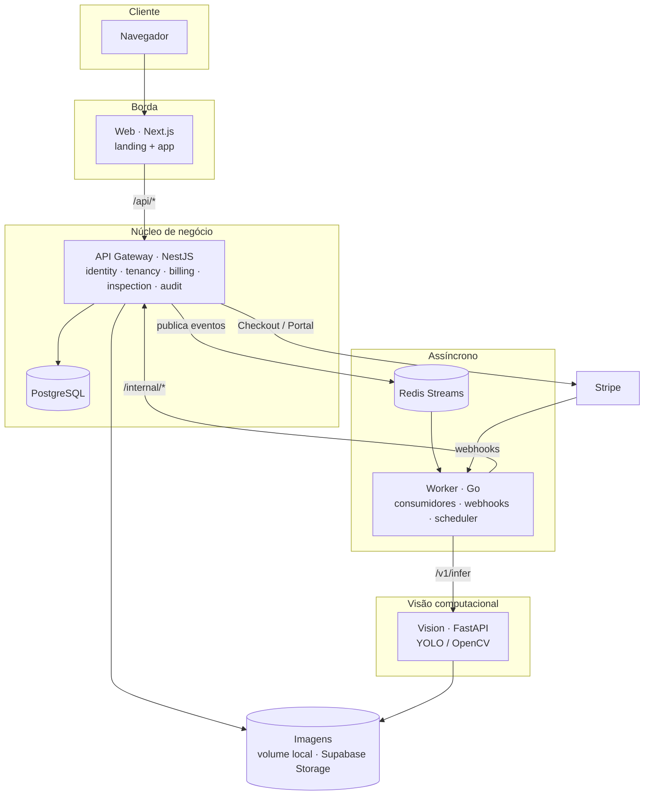

# Arquitetura

## Componentes



| Componente | Responsabilidade | Escreve no Postgres? |
|---|---|---|
| **Web** | landing de marketing e aplicação; nunca fala direto com outros serviços | não |
| **API (NestJS)** | autenticação, RBAC, multiempresa, planos e limites, assinaturas, auditoria, pedidos de análise | **sim — única** |
| **Worker (Go)** | consumir filas, chamar a visão, aplicar retry/DLQ, receber webhooks do Stripe, disparar jobs | não |
| **Vision (Python)** | inferência: recebe uma referência de imagem, devolve veredito + detecções | não |

**Uma regra guia o desenho:** a API é dona do estado. O worker e o serviço de visão são *stateless* em relação ao domínio; eles comunicam resultados por **contratos versionados** (`packages/contracts`) e a API decide o que muda. Isso mantém as invariantes (limites de plano, máquina de estados da assinatura, isolamento por tenant) num só lugar.

## Comunicação entre serviços

| De → Para | Meio | Contrato | Falhas |
|---|---|---|---|
| Web → API | HTTP (rewrite `/api/*`) | REST + JSON | erros padronizados `{ statusCode, code, message }` |
| API → Worker | Redis Stream `vision.analysis.requested` | `vision.analysis.requested.v1` | se a publicação falhar, a análise fica `QUEUED` e o job `requeue-stale-analyses` republica |
| Worker → Vision | HTTP `POST /v1/infer` | `vision.infer.request/response.v1` | 5xx/timeout → retry com backoff; 422 → falha permanente |
| Worker → API | HTTP `/internal/*` + `X-Internal-Token` | `analysis.callback.v1`, `billing.stripe.event.v1` | callbacks idempotentes; 4xx → DLQ, 5xx → retry |
| Stripe → Worker | HTTPS `POST /webhooks/stripe` | payload Stripe assinado | assinatura inválida → 400; Redis fora → 503 (o Stripe reenvia) |

Detalhes de filas, retry e DLQ em [filas.md](filas.md).

## DDD na API

Cada contexto delimitado (`apps/api/src/modules/<contexto>`) segue as mesmas quatro camadas:

```
modules/billing/
├── domain/            entidades, value objects, regras e PORTAS (interfaces) — TypeScript puro
│   ├── subscription.ts          máquina de estados da assinatura
│   ├── plan-limits.policy.ts    regras de limite por plano
│   └── ports.ts                 PlanRepository, SubscriptionRepository, PaymentGateway…
├── application/       casos de uso: orquestram domínio + portas; transações e auditoria
│   ├── billing.service.ts       planos, checkout, portal
│   ├── billing-events.service.ts aplica eventos do Stripe (idempotente)
│   └── entitlements.service.ts  porta pública consultada por outros contextos
├── infrastructure/    ADAPTADORES: Prisma, Stripe SDK, Redis, storage
└── interfaces/http/   controllers e DTOs (validação de entrada)
```

| Camada | Pode depender de | Não pode depender de |
|---|---|---|
| `domain` | nada além do kernel compartilhado (`shared/domain`) | NestJS, Prisma, Redis, Stripe — **garantido por regra de lint** (`eslint.config.mjs`) |
| `application` | `domain`, portas, kernel | detalhes de infraestrutura concretos |
| `infrastructure` | `domain` (implementa as portas), bibliotecas | `interfaces` |
| `interfaces` | `application` | `infrastructure` diretamente |

### Contextos

| Contexto | Agregados / conceitos | Expõe para outros contextos |
|---|---|---|
| **identity** | `User`, papéis e permissões, sessões de refresh | `TokenService` (guard global), `PasswordHasher` |
| **tenancy** | `Tenant` (empresa), cadastro com trial, administração da plataforma | — |
| **billing** | `Plan`, `Subscription`, eventos de cobrança, limites | `EntitlementsPort` (pode adicionar usuário? pode rodar análise?) |
| **inspection** | `Analysis`, catálogo de serviços de visão, storage e fila | — |
| **audit** | registro de ações | `AuditRecorder` (porta usada por todos) |

A comunicação entre contextos acontece por **portas de aplicação** (`shared/application/entitlements.ts`, `audit.ts`), nunca importando o repositório de outro contexto. Exemplo: `UsersService` (identity) pergunta a `EntitlementsPort` se a empresa pode ter mais um usuário; quem responde é o billing.

### Lado de leitura

Consultas de tela (dashboard, listas, painel admin) usam *query services* (`inspection.queries.ts`, `billing-admin.query.ts`) que leem direto com Prisma e devolvem projeções prontas para a UI. As escritas passam pelas entidades. É um CQRS leve: sem bancos separados, mas com responsabilidades separadas.

### Trade-offs assumidos

- **Banco único, esquemas lógicos por contexto.** Simples de operar no plano gratuito. Se um contexto precisar escalar sozinho, as portas já isolam o acesso.
- **Cadastro de empresa (tenancy) usa uma transação Prisma que toca três contextos** (tenant, usuário, assinatura). As regras vêm das entidades de cada contexto; a atomicidade vem da transação. Alternativa futura: saga com eventos de domínio.
- **Auditoria "best effort".** Falha ao gravar auditoria não derruba a operação de negócio, mas é logada.

## Segurança (resumo)

- Senhas com bcrypt; política mínima no domínio; tempo de resposta equalizado para e-mails inexistentes.
- Access token JWT HS256 de 15 min em memória no front; refresh token opaco (48 bytes) em cookie `httpOnly`, persistido só como hash SHA-256, **rotacionado a cada uso**; reuso de token revogado derruba a família inteira (proteção contra roubo).
- Isolamento multiempresa: todo acesso a dados filtra por `tenantId` do token; testes de integração cobrem acesso cruzado.
- Upload validado por *magic bytes* (não pelo Content-Type), limite de tamanho, chave de arquivo gerada pelo servidor, proteção contra path traversal na API e no serviço de visão.
- Rotas internas com token compartilhado comparado em tempo constante; em produção, mantê-las em rede privada.
- Rate limiting no login e no cadastro; `helmet` na API; cabeçalhos de segurança no Next.
- Stripe: somente chaves de teste são aceitas; eventos `livemode` são ignorados; estado da assinatura só muda por webhook assinado.
- Mensagens de erro ao usuário nunca expõem detalhes internos (URLs, stack traces).
