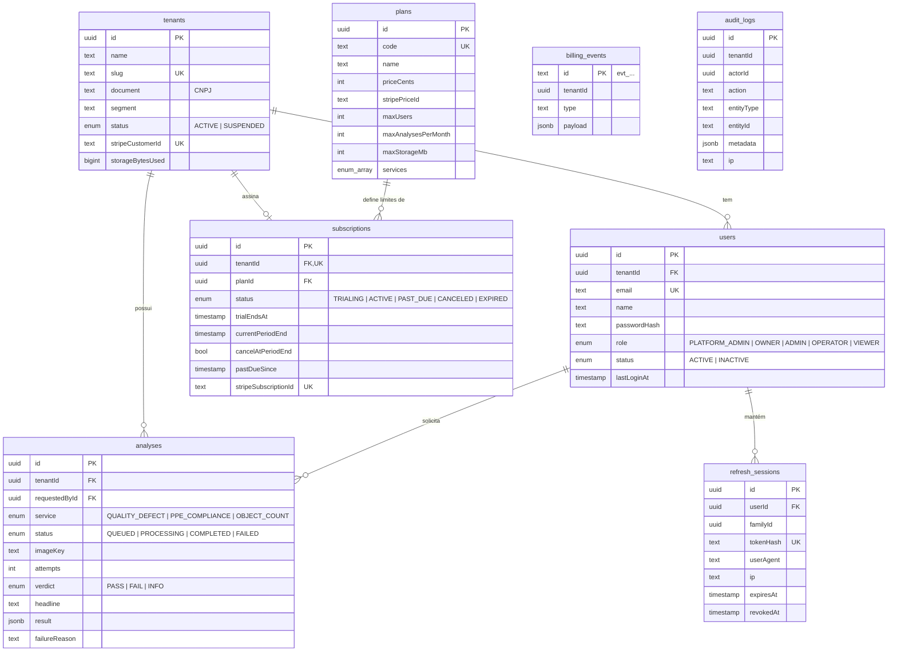

# Modelo de domínio

## Entidades principais

| Entidade | Contexto | Descrição | Invariantes principais |
|---|---|---|---|
| **Tenant** | tenancy | empresa cliente | slug único; CNPJ com dígitos verificadores válidos; empresa suspensa não autentica |
| **User** | identity | pessoa com acesso | e-mail único e normalizado; não altera o próprio papel nem se desativa; a empresa mantém ≥ 1 proprietário ativo |
| **RefreshSession** | identity | sessão de login (família de refresh tokens) | token guardado só como hash; rotação a cada uso; reuso revoga a família |
| **Plan** | billing | oferta comercial e seus limites | `-1` = ilimitado |
| **Subscription** | billing | contrato da empresa com um plano | uma por empresa; transições validadas (ver [stripe.md](stripe.md)) |
| **BillingEvent** | billing | evento de cobrança já aplicado | chave = id do evento Stripe (idempotência) |
| **Analysis** | inspection | uma imagem submetida a um serviço de visão | `QUEUED → PROCESSING → COMPLETED/FAILED`; estado final imutável; resultado precisa corresponder à análise |
| **AuditLog** | audit | registro de ação relevante | sem FKs, sobrevive a mudanças nas entidades |

Value objects / políticas: `Role` + matriz de permissões, `PlanLimitsPolicy`, política de senha, validação de imagem por *magic bytes*, catálogo `VisionService`.

## Diagrama ER

Schema completo: [`apps/api/prisma/schema.prisma`](../apps/api/prisma/schema.prisma). Migrations versionadas em `apps/api/prisma/migrations`.

## Papéis e permissões

| Permissão | Proprietário | Administrador | Operador/Inspetor | Leitura | Admin da plataforma |
|---|:-:|:-:|:-:|:-:|:-:|
| Ver painel, análises, plano | ✔ | ✔ | ✔ | ✔ | ✔ |
| Enviar e reprocessar análises | ✔ | ✔ | ✔ | | ✔ |
| Ver e gerenciar usuários | ✔ | ✔ | | | ✔ |
| Editar dados da empresa | ✔ | ✔ | | | ✔ |
| Ver auditoria | ✔ | ✔ | | | ✔ |
| Assinar plano, portal de cobrança | ✔ | | | | ✔ |
| Gerenciar empresas e ver cobrança da plataforma | | | | | ✔ |

Regras adicionais (no domínio, `identity/domain/role.ts` e `user.ts`):

- Só se atribui papel **abaixo** do próprio — exceto o proprietário, que pode promover outro proprietário.
- Administrador não gerencia proprietários nem outros administradores.
- Ninguém altera o próprio papel nem desativa a própria conta.
- `PLATFORM_ADMIN` nunca é atribuído pela API de empresas.
- Desativar usuário ou trocar senha **encerra todas as sessões** dele.

A API é a fonte da verdade (guard global + `@RequirePermissions`); o frontend apenas esconde o que não se aplica.
