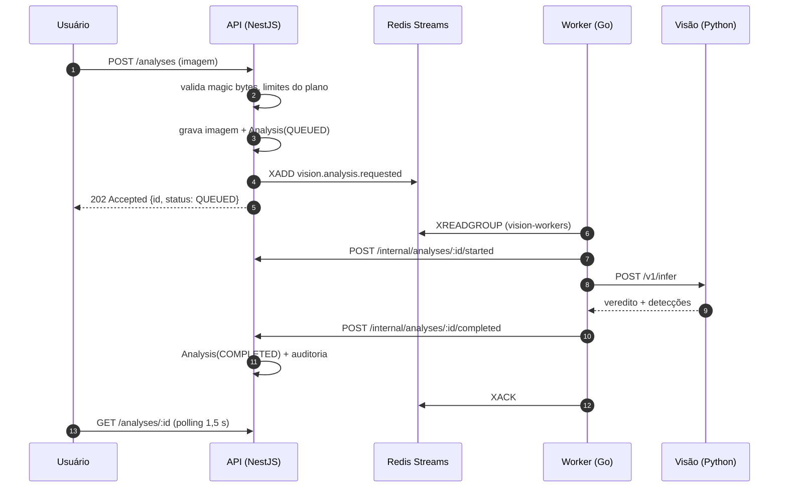
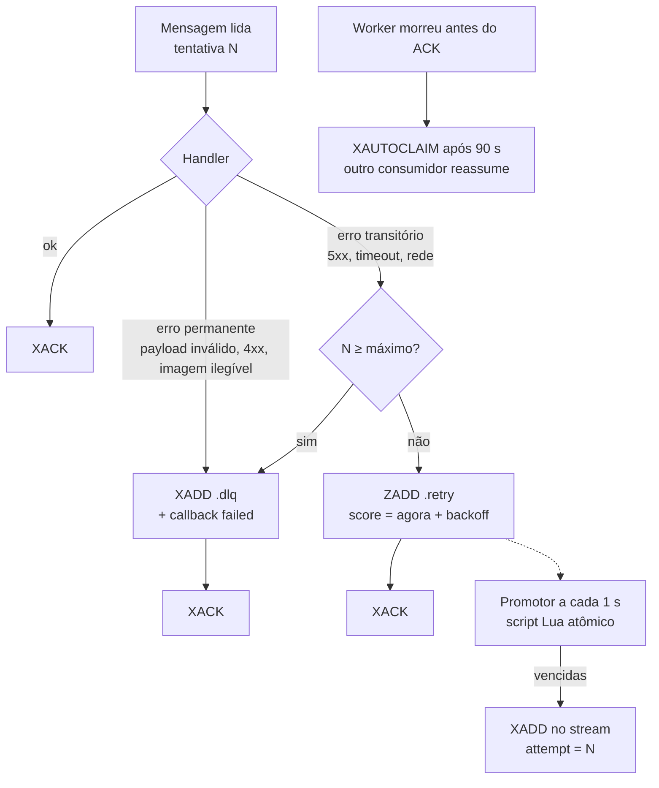

# Filas e processamento assíncrono

## Por que uma fila

Uma inferência de visão leva de dezenas de milissegundos (OpenCV) a alguns segundos (YOLO em CPU), e o serviço de visão pode estar reiniciando, carregando modelo ou saturado. Fazer isso dentro da requisição HTTP de upload traria três problemas:

1. **Acoplamento de disponibilidade** — se a visão cair, o upload falha e a imagem se perde.
2. **Picos** — 200 fotos enviadas no fim do turno travariam a API.
3. **Sem retentativa** — um erro transitório viraria erro definitivo para o usuário.

Com a fila, o upload termina em ~100 ms com `202 Accepted`, a análise fica `QUEUED` no banco e o processamento acontece no ritmo que os workers aguentam, com retry automático.

## Por que Go para essa parte

| Necessidade | Como o Go atende |
|---|---|
| Muitas operações de I/O concorrentes (fila, HTTP para visão, HTTP para API) | goroutines + `context` com timeout por mensagem |
| Rodar 24/7 em instância gratuita com 512 MB | binário estático de ~10 MB, ~15 MB de RAM em uso |
| Receber webhooks com resposta rápida | `net/http` da biblioteca padrão, sem framework |
| Confiabilidade | `go test -race` no CI; tipagem forte dos contratos |

O Go **não** foi usado para regras de negócio: a decisão do que fazer com um resultado é sempre da API. O worker é infraestrutura de entrega.

## Broker: Redis Streams

| Alternativa | Por que não (agora) |
|---|---|
| RabbitMQ | excelente, mas é mais um serviço para operar e não há plano gratuito gerenciado confortável |
| NATS JetStream | ótimo desempenho; mesma questão operacional |
| BullMQ | prende o worker ao Node.js |
| Postgres `SKIP LOCKED` | viável, mas aumenta carga no banco do plano gratuito (500 MB) |
| **Redis Streams** ✔ | consumer groups, ACK explícito, lista de pendentes, XAUTOCLAIM, persistência (AOF); Redis gerenciado gratuito (Upstash) e já útil para deduplicação e locks |

## Streams e chaves

| Chave | Tipo | Produtor | Consumidor (grupo) |
|---|---|---|---|
| `vision.analysis.requested` | Stream | API | Worker (`vision-workers`) |
| `vision.analysis.requested.retry` | Sorted set (score = horário de reentrega) | Worker | Worker (promotor) |
| `vision.analysis.requested.dlq` | Stream | Worker | operação / painel |
| `billing.stripe.events` | Stream | Worker (webhook) | Worker (`billing-workers`) |
| `billing.stripe.events.retry` / `.dlq` | idem | Worker | Worker / operação |
| `stripe:event:<id>` | String com TTL de 7 dias | Worker (webhook) | deduplicação |
| `lock:job:<nome>` | String com TTL | Worker (scheduler) | exclusão mútua entre réplicas |

Cada entrada de stream tem os campos `type`, `payload` (JSON do contrato) e `attempt` (tentativas já feitas).

## Eventos

| Evento | Versão | Schema |
|---|---|---|
| `vision.analysis.requested` | 1 | [`packages/contracts/schemas/vision.analysis.requested.v1.json`](../packages/contracts/schemas/vision.analysis.requested.v1.json) |
| Evento bruto do Stripe (`checkout.session.completed`, `invoice.paid`, `invoice.payment_failed`, `customer.subscription.updated`, `customer.subscription.deleted`) | API do Stripe | validado por assinatura, traduzido para `billing.stripe.event.v1` |

## Fluxo de uma análise

## Retry e falha

- **Backoff exponencial com jitter**: `base · 2^(N-1)`, limitado (`WORKER_BASE_BACKOFF`, `WORKER_MAX_BACKOFF`), sorteado na metade superior para espalhar picos.
- **Máximo de tentativas**: `WORKER_MAX_ATTEMPTS` (padrão 3) para análises; 8 para eventos de cobrança, que não podem ser perdidos.
- **Pânico no handler** é capturado e tratado como erro transitório — um bug não derruba o processo.
- **Entrega at-least-once**: a mesma mensagem pode ser processada duas vezes (ex.: queda entre o callback e o ACK). Por isso todos os callbacks da API são idempotentes: uma análise em estado final ignora novos callbacks, e eventos de cobrança são deduplicados por `eventId`.
- **Rede de segurança**: o job `requeue-stale-analyses` (a cada 5 min) republica análises presas em `QUEUED` (falha na publicação) ou `PROCESSING` há mais de 15 min.
- **Mensagem ao usuário**: falhas definitivas viram um texto legível na análise ("Serviço de visão indisponível após 3 tentativas…"), sem expor detalhes internos; o detalhe técnico fica no log do worker.
- **Shutdown gracioso**: em `SIGTERM` o worker para de ler, termina as mensagens em andamento e só então encerra; o que não terminou continua pendente e é reassumido.

## Como o serviço Python é acionado

Pelo worker, via HTTP síncrono (`POST /v1/infer`) dentro do processamento de cada mensagem. A imagem não trafega na fila: vai apenas uma referência (`storage` + `key`, ou URL assinada temporária quando o storage é o Supabase). Isso mantém as mensagens pequenas e permite escalar a visão independentemente (mais réplicas atrás de um balanceador, ou GPU).

## Jobs periódicos

| Job | Intervalo | O que faz |
|---|---|---|
| `requeue-stale-analyses` | 5 min | republica análises paradas |
| `expire-subscriptions` | 1 h | trial vencido → `EXPIRED`; `PAST_DUE` além da carência → `EXPIRED`; cancelada após o período pago → `EXPIRED` |
| `cleanup-files` | 24 h | apaga imagens além do prazo de retenção (`FILE_RETENTION_DAYS`) e libera a cota de armazenamento |

O worker só **dispara** (`POST /internal/jobs/<nome>`); a lógica fica na API. Um lock `SET NX` no Redis garante que, com várias réplicas do worker, cada job rode uma vez por ciclo.

## Observabilidade

- Logs JSON estruturados (`log/slog`) com `msgId`, `attempt`, `analysisId`.
- `GET /metrics` no worker: contadores `processed`, `retried`, `dead_lettered`, `reclaimed`, `webhook.accepted|duplicate|rejected`.
- `GET /healthz` (vivo) e `GET /readyz` (Redis acessível).
- Inspeção manual da DLQ: `redis-cli XRANGE vision.analysis.requested.dlq - +`.
