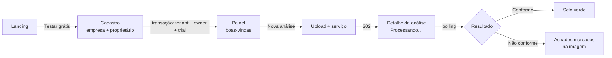
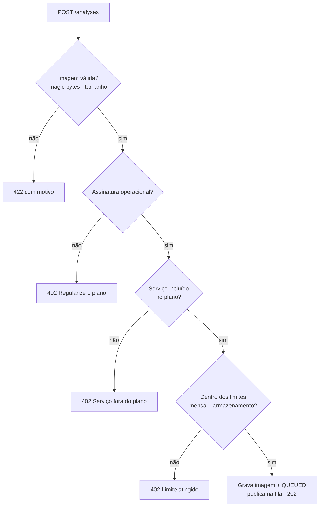
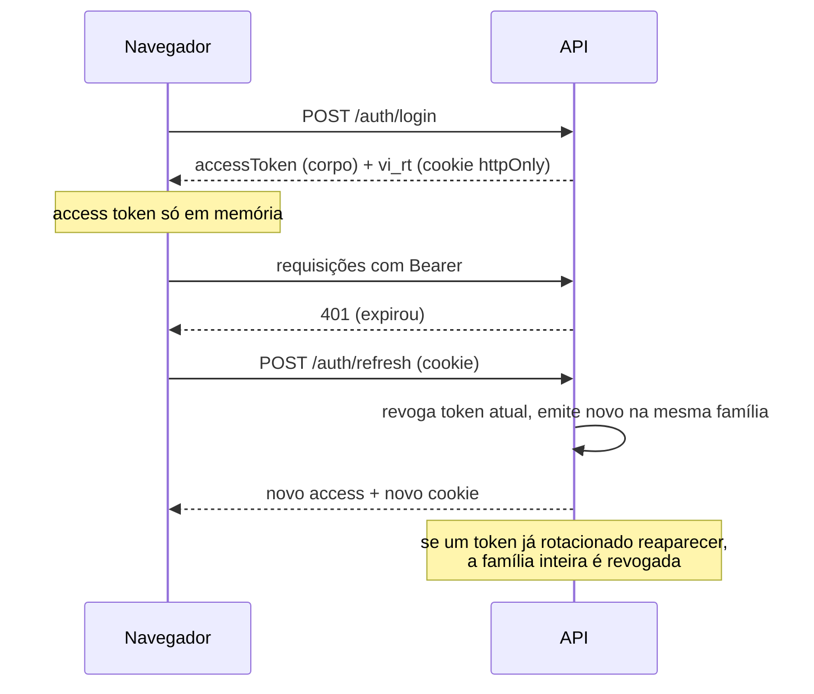

# Produto: casos de uso, histórias e fluxos

## Personas

| Persona | Papel no sistema | Objetivo |
|---|---|---|
| **Carla**, gerente industrial | Proprietária | reduzir devolução por defeito e provar conformidade em auditorias |
| **Rafael**, coordenador de TI/qualidade | Administrador | colocar a equipe no sistema e manter os dados da empresa |
| **Juliana**, inspetora de qualidade | Operadora | registrar inspeções rápido, no chão de fábrica, pelo celular |
| **Marcos**, técnico de segurança | Leitura | acompanhar não conformidades de EPI e gerar evidências para a CIPA |
| **Equipe Vision Inspect** | Admin da plataforma | acompanhar clientes, assinaturas e cobrança |

## Casos de uso

| ID | Caso de uso | Ator | Pré-condição | Resultado |
|---|---|---|---|---|
| UC01 | Criar conta da empresa (trial) | visitante | — | empresa + proprietário + assinatura `TRIALING`, já autenticado |
| UC02 | Entrar / sair | todos | usuário ativo, empresa ativa | sessão com access + refresh token |
| UC03 | Gerenciar sessões | todos | autenticado | listar dispositivos e encerrar sessões |
| UC04 | Gerenciar usuários | proprietário, admin | assinatura operacional; limite do plano | criar, alterar papel, desativar, reativar |
| UC05 | Enviar imagem para análise | operador+ | serviço incluso no plano; limites mensais | análise `QUEUED`, processada assincronamente |
| UC06 | Consultar resultado | todos | — | veredito, métricas, detecções sobre a imagem |
| UC07 | Reprocessar análise com falha | operador+ | análise `FAILED` | análise volta à fila |
| UC08 | Acompanhar indicadores | todos | — | conformidade do mês, série de 14 dias, por serviço |
| UC09 | Assinar / trocar plano | proprietário | Stripe configurado (teste) | checkout hospedado; assinatura `ACTIVE` via webhook |
| UC10 | Gerenciar pagamento | proprietário | cliente Stripe existente | portal do cliente |
| UC11 | Consultar auditoria | proprietário, admin | — | trilha filtrável por tipo de evento |
| UC12 | Administrar a plataforma | admin da plataforma | — | ver empresas, assinaturas, receita; suspender/reativar empresa |
| UC13 | Expirar assinaturas e limpar imagens | sistema (scheduler) | — | estados atualizados, retenção aplicada |

## Histórias de usuário

**Inspeção**

- *Como inspetora*, quero fotografar uma peça e saber em segundos se ela tem defeito, **para** separar o lote antes da expedição.
  - Critérios: upload de JPEG/PNG/WebP até 10 MB; arquivo inválido é recusado com mensagem clara; resultado aparece sem recarregar a página; cada defeito é marcado na imagem com tipo e confiança.
- *Como técnico de segurança*, quero ver quem estava sem capacete na área de prensas, **para** agir antes de um acidente e registrar a ocorrência.
  - Critérios: pessoas sem capacete aparecem como "crítico"; sem colete como "atenção"; o painel mostra a taxa de conformidade por serviço.
- *Como supervisora de expedição*, quero contar as caixas de um palete por foto, **para** conferir com a ordem antes do carregamento.

**Gestão**

- *Como proprietária*, quero convidar a equipe com papéis diferentes, **para** que cada um veja só o que precisa.
  - Critérios: administrador não promove ninguém a administrador; o sistema impede ficar sem proprietário; usuário desativado perde a sessão imediatamente.
- *Como proprietária*, quero testar 14 dias sem cartão e assinar depois, **para** validar antes de comprar.
- *Como administrador*, quero uma trilha de auditoria de logins e alterações, **para** responder a auditorias ISO e LGPD.

**Plataforma**

- *Como equipe da Vision Inspect*, quero ver quais clientes estão com pagamento pendente, **para** agir antes do bloqueio.

## Fluxos principais

### Cadastro e primeiro resultado

### Pedido de análise (regras)

### Sessão (login, refresh, reuso)

