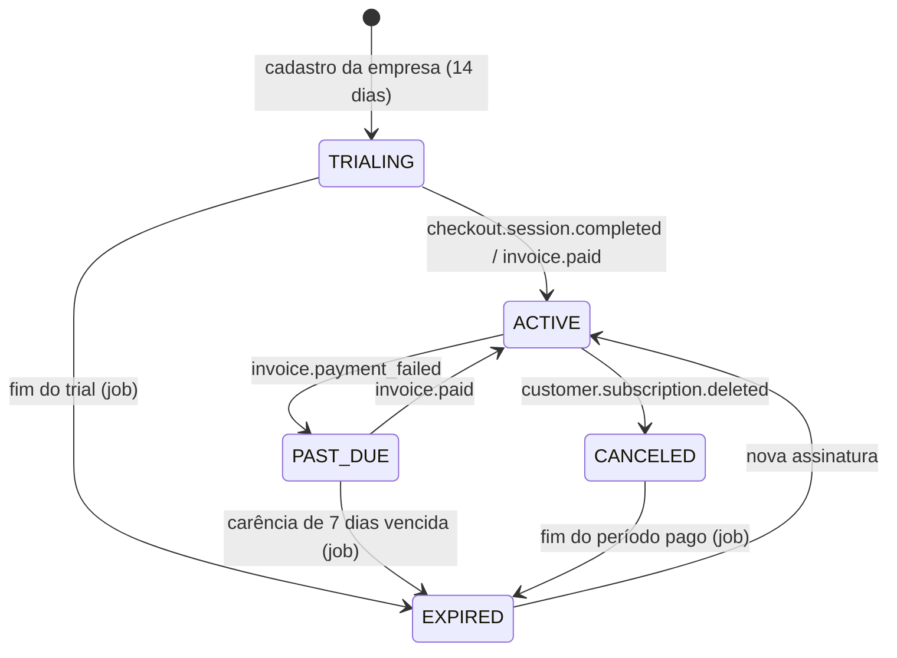
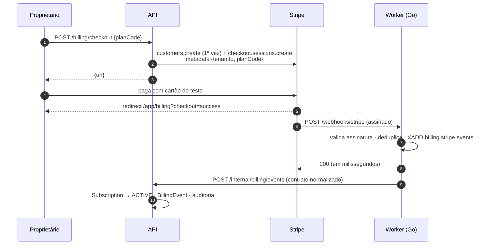

# Integração com o Stripe

> O sistema opera **somente em modo de teste**. A API recusa iniciar com uma chave que não comece com `sk_test_`/`rk_test_`, e eventos com `livemode: true` são ignorados. Nenhuma cobrança real é possível nesta configuração.

## Planos

| Código | Nome | Preço | Usuários | Análises/mês | Armazenamento | Serviços |
|---|---|---|---|---|---|---|
| `STARTER` | Essencial | R$ 690/mês | 5 | 300 | 2 GB | Qualidade, Contagem |
| `PRO` | Profissional | R$ 1.890/mês | 20 | 3.000 | 20 GB | Qualidade, EPI, Contagem |
| `ENTERPRISE` | Enterprise | sob consulta | ilimitado | ilimitado | ilimitado | todos |

O catálogo vive em `apps/api/prisma/plans.ts` (seed). Cada plano pago aponta para um **Price** do Stripe (`stripePriceId`), criado por:

```bash
STRIPE_SECRET_KEY=sk_test_... npm run stripe:bootstrap -w apps/api
```

O script é idempotente (usa `lookup_key`) e imprime as linhas `STRIPE_PRICE_*` para o `.env`. Depois rode o seed de novo para gravar os IDs nos planos.

## Ciclo de vida da assinatura



| Status | Pode operar? | Observação |
|---|---|---|
| `TRIALING` | sim, até `trialEndsAt` | limites do plano escolhido no cadastro |
| `ACTIVE` | sim | renovação atualiza `currentPeriodEnd` |
| `PAST_DUE` (pendente) | sim, por `PAST_DUE_GRACE_DAYS` | banner no painel pedindo atualização do cartão |
| `CANCELED` | até o fim do período pago | |
| `EXPIRED` | não | leitura liberada, novas análises e usuários bloqueados (HTTP 402) |

As transições são validadas pela entidade `Subscription` (`apps/api/src/modules/billing/domain/subscription.ts`) e cobertas por testes unitários.

## Fluxo de checkout



**O redirect de sucesso não altera nada no banco** — ele pode ser forjado. O estado só muda pelo webhook assinado.

## Webhooks

Endpoint: `POST {WORKER_URL}/webhooks/stripe` (worker Go).

1. **Assinatura**: esquema `v1` do Stripe (HMAC-SHA256 de `"<timestamp>.<payload>"` com o `whsec_`), tolerância de 5 min contra replay, suporte a múltiplas assinaturas durante rotação de segredo. Implementação em `services/worker/internal/billing/signature.go`.
2. **Deduplicação**: `SET stripe:event:<id> NX EX 7d`. O Stripe reenvia eventos; reenvios respondem `200 {duplicate: true}`.
3. **Enfileiramento**: o payload bruto vai para `billing.stripe.events`; o HTTP responde imediatamente. Se o Redis estiver fora, responde `503` e o Stripe tenta de novo.
4. **Tradução**: o consumidor converte o evento bruto para o contrato estável `billing.stripe.event.v1`, tolerando as duas formas da API do Stripe (campos de assinatura no topo da fatura em versões antigas; em `parent.subscription_details` nas versões 2025+).
5. **Aplicação**: `POST /internal/billing/events` na API, idempotente por `eventId` (tabela `billing_events`).

### Eventos tratados

| Evento Stripe | Evento interno | Efeito |
|---|---|---|
| `checkout.session.completed` (modo assinatura) | `checkout.completed` | vincula customer/subscription, troca o plano, `ACTIVE` |
| `invoice.paid` | `invoice.paid` | `ACTIVE`, atualiza período, limpa pendência |
| `invoice.payment_failed` | `invoice.payment_failed` | `PAST_DUE` (inicia carência) |
| `customer.subscription.updated` | `subscription.updated` | sincroniza status, plano (pelo price), `cancel_at_period_end` |
| `customer.subscription.deleted` | `subscription.canceled` | `CANCELED` |

Qualquer outro tipo é respondido com `200 {ignored: true}` e não entra na fila.

A empresa é localizada, nesta ordem, por `subscriptionId`, `metadata.tenantId` ou `customerId`.

## Testando localmente

```bash
# terminal 1 — stack rodando (docker compose up ou modo dev)
# terminal 2 — encaminhar webhooks
stripe login
stripe listen --forward-to localhost:8080/webhooks/stripe
# copie o "whsec_..." para STRIPE_WEBHOOK_SECRET e reinicie o worker

# disparar eventos de teste
stripe trigger checkout.session.completed
stripe trigger invoice.payment_failed
```

| Cartão de teste | Resultado |
|---|---|
| `4242 4242 4242 4242` | pagamento aprovado |
| `4000 0000 0000 0341` | anexa, mas falha na cobrança (gera `invoice.payment_failed`) |
| `4000 0027 6000 3184` | exige autenticação 3DS |

Use qualquer data futura e qualquer CVC. Para simular renovação, avance o relógio com **Test clocks** no Dashboard do Stripe.

## Portal do cliente

`POST /billing/portal` gera uma sessão do Customer Portal (trocar cartão, ver faturas, cancelar). Ative o portal em *Dashboard → Settings → Billing → Customer portal* (modo teste).

## Painel administrativo

`/app/admin` (papel `PLATFORM_ADMIN`) mostra empresas, status de assinatura, receita recorrente mensal estimada (soma das assinaturas `ACTIVE`) e os últimos eventos de cobrança recebidos.
