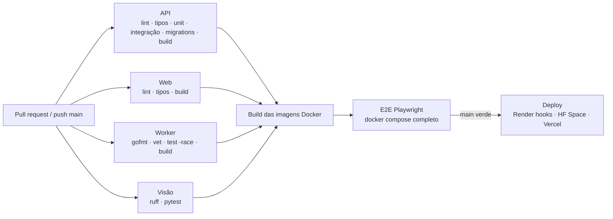

# Testes e CI/CD

## Estratégia

Testes onde eles evitam regressão real, não para inflar cobertura.

| Nível | Onde | Ferramenta | Foco | Mocks? |
|---|---|---|---|---|
| **Unitário** | `apps/api/src/**/*.spec.ts` | Jest | entidades e políticas (RBAC, limites de plano, máquina de estados da assinatura, ciclo da análise, CNPJ, senha), casos de uso com repositórios em memória (rotação/reuso de refresh token, eventos de cobrança, publicação de análise) | só portas (fakes em memória) |
| **Contrato** | Jest (ajv), `go test`, pytest | — | exemplos de `packages/contracts` validados nos três serviços; o evento publicado pela API é validado contra o JSON Schema | não |
| **Integração** | `apps/api/test/*.int-spec.ts` | Jest + supertest | HTTP real, Postgres e Redis reais: signup, login, refresh por cookie com reuso, RBAC, isolamento entre empresas, validação de payload, upload → stream → callbacks, limites (402), eventos de cobrança idempotentes, checkout real no Stripe test mode (se houver chave) | não |
| **Fila / worker** | `services/worker/internal/**/_test.go` | go test + miniredis | ACK, retry agendado e promovido, máximo de tentativas → DLQ, falha permanente, pânico, XAUTOCLAIM de consumidor morto, backoff, assinatura de webhook (válida, adulterada, replay, rotação), mapeamento dos formatos do Stripe, deduplicação, lock entre réplicas | HTTP da API e da visão via fakes de interface |
| **Visão** | `services/vision/tests` | pytest | acurácia mínima dos detectores sobre dados sintéticos, diversidade de tons de pele, contrato da resposta, path traversal e arquivos inválidos (422), regras do backend YOLO com modelo falso | modelo YOLO falso (sem PyTorch) |
| **E2E** | `apps/web/e2e` | Playwright | landing; login e erro; criar usuário, trocar papel e desativar; operadora envia imagem e vê o resultado **processado pela fila real** (worker Go + visão Python); checkout de teste (opcional) | não — stack completa |

Mocks só onde a integração externa não deve ser chamada no teste: o Stripe real só é chamado com chave de teste presente (`STRIPE_TEST_SECRET_KEY` nos secrets do repositório).

### Rodando localmente

```bash
docker compose up -d postgres redis
npm test -w apps/api                       # unitários
npm run test:integration -w apps/api       # integração (usa o banco vision_test)
cd services/worker && go test -race ./...
cd services/vision && pytest
docker compose up -d --build && npm run test:e2e -w apps/web
```

O banco `vision_test` é criado automaticamente pelo `docker compose` (`infra/postgres/init.sql`) e recriado a cada execução aplicando as mesmas migrations SQL versionadas (`test/setup/global-setup.ts`).

## Pipeline (GitHub Actions)



Arquivos: [`.github/workflows/ci.yml`](../.github/workflows/ci.yml) e [`.github/workflows/deploy.yml`](../.github/workflows/deploy.yml).

## Proteção de branch

Os checks acima são obrigatórios para o merge na `main`. Para aplicar (uma vez, com GitHub CLI autenticado como admin do repositório):

```bash
./scripts/setup-branch-protection.sh SEU_USUARIO/vision-inspection
```

O script configura: PR obrigatório, checks `API (NestJS)`, `Web (Next.js)`, `Worker (Go)`, `Visão (Python)`, `Build das imagens Docker` e `E2E (Playwright)` exigidos e atualizados com a `main`, histórico linear, sem force-push. Também é possível configurar em *Settings → Branches → Branch protection rules*.

> Observação: o GitHub só lista um check como "obrigatório" depois que ele rodou ao menos uma vez. Abra um primeiro PR antes de aplicar a proteção.

## Secrets do repositório

| Secret | Uso | Obrigatório |
|---|---|---|
| `STRIPE_TEST_SECRET_KEY`, `STRIPE_TEST_PRICE_PRO` | teste de integração com checkout real em modo de teste | não |
| `RENDER_DEPLOY_HOOK_API`, `RENDER_DEPLOY_HOOK_WORKER` | deploy da API e do worker | para deploy |
| `HF_TOKEN` + variável `HF_SPACE` | deploy do serviço de visão no Hugging Face Spaces | para deploy |
